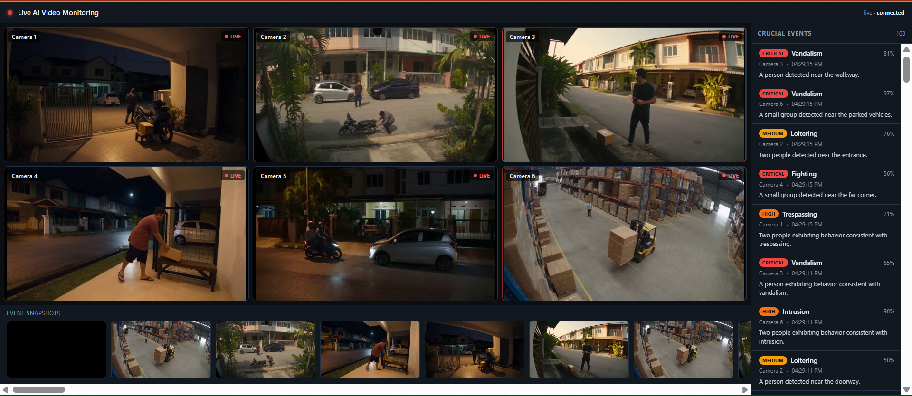
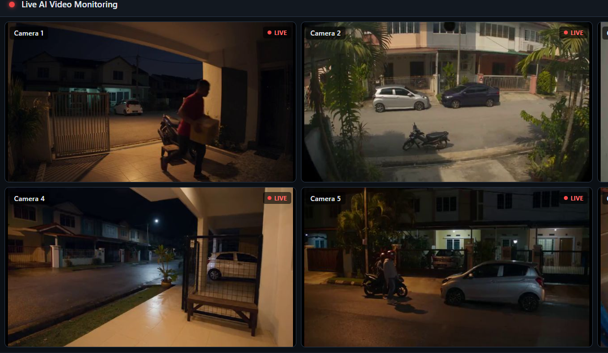
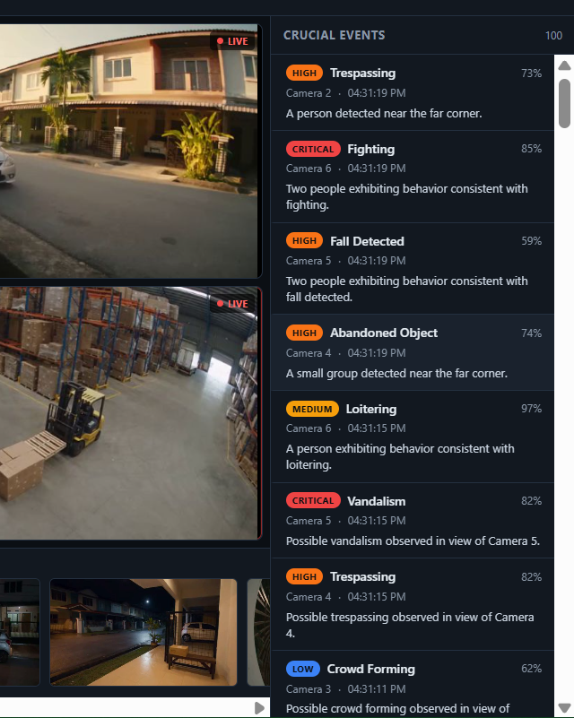
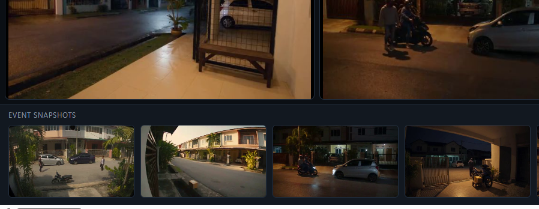

# Live Multi-Feed AI Video Monitoring (DGX Spark)

A CCTV-style monitoring dashboard. It plays multiple looping video feeds (up
to 9), runs AI behavior analysis on each feed, and shows:

- a **video wall** (main area) with the live feeds,
- a **right panel** listing crucial events (time, camera, type, confidence,
  colored severity badge, and an AI-generated description),
- a **bottom panel** of snapshot thumbnails showing where each event happened.

The AI runs behind a **swappable adapter**. It ships with a built-in mock so
the whole dashboard works immediately, and a ready-to-fill OpenAI-compatible
adapter for your real "omni" model on the DGX Spark.

```
┌─────────────────────────────────────┬──────────────────┐
│  HEADER (status)                                        │
├─────────────────────────────────────┼──────────────────┤
│                                      │                  │
│          VIDEO WALL                  │   CRUCIAL EVENTS │
│      (1–9 looping feeds)             │   (live list)    │
│                                      │                  │
├─────────────────────────────────────┤                  │
│      EVENT SNAPSHOTS (thumbnails)    │                  │
└─────────────────────────────────────┴──────────────────┘
```

---

## Screenshots

> Drop your screenshot image files into `docs/screenshots/` with the exact
> names below and they will render here on GitHub. (See
> `docs/screenshots/README.md` for the expected files.)

### Dashboard — full view

The video wall, live event list, and snapshot strip together.



### Video wall

Multiple live feeds in a grid.



### Crucial events panel

Live event list with colored severity badges and AI-generated descriptions.



### Event snapshots

Frame thumbnails showing where each event happened; click one to enlarge.



---

## Quick start (Windows / PowerShell)

```powershell
# 1. Backend deps (one time)
cd backend
python -m venv .venv
.\.venv\Scripts\python.exe -m pip install -r requirements.txt
cd ..

# 2. Generate sample videos (or drop your own clips into videos/)
backend\.venv\Scripts\python.exe scripts\make_sample_videos.py

# 3. Run the server
cd backend
.\.venv\Scripts\python.exe -m uvicorn app.main:app --host 0.0.0.0 --port 8888
```

Then open **http://localhost:8888** in a browser. That's it — no npm, no build.

---

## Running on the DGX Spark (Linux / ARM64)

The DGX Spark runs DGX OS (Ubuntu-based). The steps are the same as above but
use the Linux venv path (`.venv/bin/python`, not `.venv\Scripts\...`).

### 1. Get the project onto the Spark

```bash
git clone <your-repo-url> dgx-monitoring
cd dgx-monitoring
```

(or `scp -r` the folder across from your laptop.)

### 2. One-time setup

```bash
cd backend
python3 -m venv .venv
./.venv/bin/python -m pip install --upgrade pip
./.venv/bin/python -m pip install -r requirements.txt
cd ..
```

> If OpenCV complains about a missing shared library on a headless Spark,
> install the usual runtime libs:
> `sudo apt-get update && sudo apt-get install -y libgl1 libglib2.0-0`

### 3. Add your video clips

Copy your `.mp4` files into `videos/` and list them in
`config/watchlist.yaml` (see "Using your own video clips" below). No sample
generator needed if you already have footage.

### 4. Run the server

```bash
cd backend
./.venv/bin/python -m uvicorn app.main:app --host 0.0.0.0 --port 8888
```

`--host 0.0.0.0` makes it reachable from other machines on the network.

### 5. Open the dashboard

- **On the Spark itself (with a desktop/browser):** http://localhost:8888
- **From your laptop on the same network:** find the Spark's IP with
  `hostname -I` (take the first address, e.g. `192.168.1.42`), then open
  `http://192.168.1.42:8888` in your laptop's browser.

> Note: `0.0.0.0` is the *bind* address, not something you type in a browser.
> Always use `localhost`, `127.0.0.1`, or the Spark's real IP.

### 6. Point it at your omni model on the Spark

The whole reason to run on the Spark is to use the GPU for your omni model.
Serve the model locally with an OpenAI-compatible API, then set in
`config/watchlist.yaml`:

```yaml
model:
  adapter: "openai"
  base_url: "http://localhost:8000/v1"   # your omni server on the Spark
  model_name: "omni"
```

See **"Plug in your omni model"** below for the full details. Until then it
runs on the built-in mock, so you can verify the pipeline + dashboard first.

### Keeping it running (optional)

For a demo that survives your SSH session closing:

```bash
# simplest: run in the background with a log file
cd backend
nohup ./.venv/bin/python -m uvicorn app.main:app --host 0.0.0.0 --port 8888 \
  > ../server.log 2>&1 &

# follow the log
tail -f ../server.log
```

To stop it later: `pkill -f "uvicorn app.main:app"`.

### Troubleshooting

| Symptom | Fix |
|---------|-----|
| `This site can't be reached` | You used `0.0.0.0` in the browser. Use `localhost` / the Spark IP. |
| Can't reach it from your laptop | Server must bind `--host 0.0.0.0`; check the Spark's firewall allows port 8888. |
| `libGL.so.1: cannot open` | `sudo apt-get install -y libgl1 libglib2.0-0` |
| Port already in use | Pick another port, e.g. `--port 8090`. |
| Feeds show "NO SIGNAL" | The `source:` path in the config doesn't match a file in `videos/`. |

---

## Using your own video clips

Drop video files into the `videos/` folder and point `config/watchlist.yaml`
at them. Each feed looks like:

```yaml
feeds:
  - id: cam-1
    name: "Entrance - North"
    source: "videos/your-clip.mp4"
```

1–4 feeds are supported. Feeds loop forever to simulate a live camera. A
missing file shows a "NO SIGNAL" placeholder instead of crashing.

---

## Editing the watchlist

The watchlist tells the model which behaviors to look for and drives the
severity colors in the UI. Edit `config/watchlist.yaml`:

```yaml
watchlist:
  - type: "Loitering"
    description: "A person remaining in one area for an extended period."
    severity: medium        # low | medium | high | critical
```

`analysis` controls how often and how many frames are analyzed per feed:

```yaml
analysis:
  interval_seconds: 4.0     # seconds between analysis passes per feed
  batch_size: 4             # frames sent to the model as a short clip
  batch_stride: 5           # spacing between chosen frames
```

---

## Plug in your omni model (the one change that matters)

Everything downstream — the event list, snapshots, colors, streaming — is
identical whether events come from the mock or your real model. Swapping in the
real model is a **config change plus filling two TODOs**.

### Step 1 — serve your omni model

Serve your "omni" model on the DGX Spark with an OpenAI-compatible API
(vLLM, Ollama, llama.cpp server, etc.).

### Step 2 — point the config at it

In `config/watchlist.yaml`:

```yaml
model:
  adapter: "openai"                     # was "mock"
  base_url: "http://localhost:8000/v1"  # your omni server
  api_key: "not-needed-for-local"
  model_name: "omni"                    # your served model name
```

### Step 3 — adapt the request to your model (if needed)

Open `models/omni_adapter.py` and look at `OpenAICompatibleAdapter`. Two TODO
markers show where to tune:

- `_build_prompt(...)` — the behavior-analysis prompt.
- `_build_payload(...)` — the request body (image batch vs. video input,
  `max_tokens` naming, etc.).

The adapter already sends the recent frame batch as images and parses a JSON
`{"events": [...]}` reply (tolerant of markdown fences / stray prose).

### Writing a totally different adapter

Subclass `OmniAdapter`, implement:

```python
def analyze(self, frames, watchlist, camera_id, camera_name) -> list[Event]:
    ...
```

then register it in `build_adapter(...)` at the bottom of the file. `frames` is
a short chronological clip (list of BGR numpy arrays); return zero or more
`Event` objects.

---

## Architecture

```
Video files ──> VideoFeed (loop) ──> recent-frame buffer
                                           │
                       every interval, grab a short clip
                                           ▼
                 Analysis queue (async, drops stale work under load)
                                           ▼
                 Omni Adapter  (mock  |  openai-compatible  |  yours)
                                           ▼
                 In-memory Event Store ──> WebSocket push ──> UI panels
                        │
                        └─> /snapshot/{id}  (JPEG of the triggering frame)

VideoFeed ──> /stream/{feed_id}  (MJPEG) ──> video wall
```

Design choices for the hackathon:

- **Video never blocks on the model.** Analysis runs on worker threads via a
  bounded queue; under backpressure the oldest pending batch is dropped so we
  always analyze fresh frames.
- **The adapter is one isolated module** with a mock, so the dashboard demos
  before the real model exists.
- **Event history is in-memory** (resets on restart), as requested.

---

## HTTP / WS API

| Method | Path                 | Purpose                                  |
|--------|----------------------|------------------------------------------|
| GET    | `/`                  | The dashboard (single static HTML page)  |
| GET    | `/api/config`        | Feeds + watchlist + severity colors      |
| GET    | `/api/status`        | Feed + pipeline diagnostics              |
| GET    | `/api/events?limit=` | Recent events (JSON, newest first)       |
| GET    | `/stream/{feed_id}`   | MJPEG live stream for a feed             |
| GET    | `/snapshot/{event_id}`| JPEG snapshot for an event              |
| WS     | `/ws/events`         | Live event push (sends a backlog first)  |

---

## Tests

```powershell
cd backend
.\.venv\Scripts\python.exe -m pytest -q
```

Covers config validation, video looping/buffering, the omni adapter + mock,
the analysis pipeline (batching + backpressure drop + error resilience), the
event store, and an end-to-end smoke test (stream content type + event flow +
snapshot).

---

## Project layout

```
backend/
  app/
    main.py          FastAPI app: streams, websocket, snapshots, serves UI
    config.py        YAML config loader + validation
    video.py         Looping VideoFeed + FeedManager
    pipeline.py      Async frame batcher + analysis workers
    event_store.py   In-memory ring buffer + WebSocket broadcaster
    models.py        Shared Event model
    static/
      index.html     The single-file dashboard (no build step)
  tests/             Pytest suite
  requirements.txt
config/
  watchlist.yaml     Feeds + watchlist + analysis + model settings
models/
  omni_adapter.py    >>> PLUG IN YOUR OMNI MODEL HERE <<<
scripts/
  make_sample_videos.py
videos/              Drop your .mp4 clips here
```
